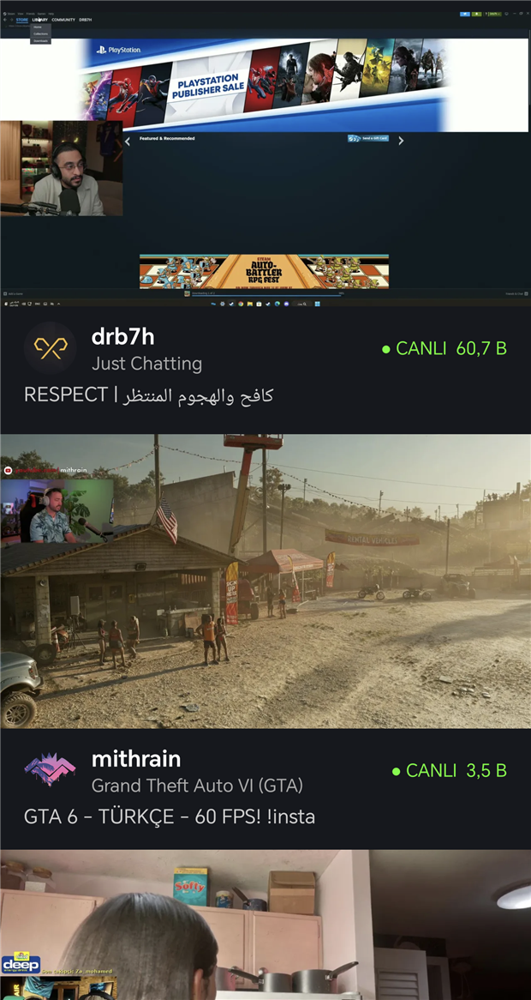
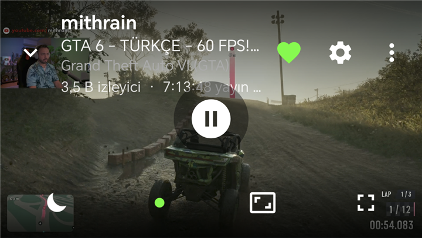
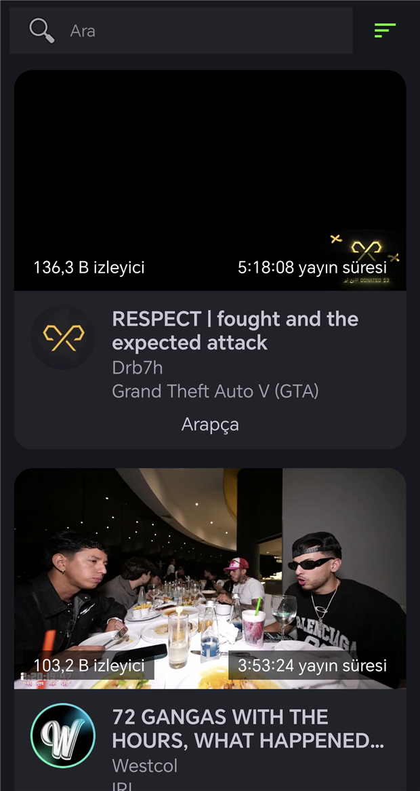

<p align="center">
  
</p>

<h1 align="center">Xick</h1>

<p align="center">
  <b>An unofficial, lightweight Android client for <a href="https://kick.com">Kick</a>.</b><br>
  Low data usage, a clean interface, and a player built for long streams.
</p>

<p align="center">
  
  
  
</p>

<p align="center">
  <b>English</b> · <a href="README.tr.md">Türkçe</a>
</p>

> Xick is not affiliated with or endorsed by Kick. "Kick" is a trademark of its owner.

---

## Screenshots

<table align="center">
  <tr>
    <td align="center"><br><sub>Followed channels that are live</sub></td>
    <td align="center"><br><sub>Live player with controls</sub></td>
    <td align="center"><br><sub>Popular channels</sub></td>
  </tr>
</table>

## Features

**Browse**
- Popular live channels and categories with infinite scroll
- Channel and category search, filter by language

**Watch**
- Live HLS playback with quality selection
- Fit, zoom and fill display modes; fullscreen
- Mini player: drag down to shrink, swipe sideways to dismiss
- Audio-only mode and a sleep timer
- Screen stays on while playing, for up to 30 minutes
- Video archives (VOD) and clips for each channel

**Chat**
- Live chat with inline emotes
- Send messages after signing in

**Following**
- Sign in with your Kick account on Kick's own page (your password is never seen by the app)
- See the channels you follow that are live right now
- Follow and unfollow from the player and the list

## Data-saving design

- Thumbnails use the smallest suitable size on mobile data (`DataSaverPolicy.pickThumbnailUrl`).
- Video is capped at 480p on mobile data by default; you can change it.
- HTTP responses are cached using the server's `Cache-Control` headers.
- Emotes are loaded only when they appear in a message.
- Secondary chat data loads only when its tab is opened.

## Architecture

- MVVM with repositories and Paging 3
- Media3 / ExoPlayer for HLS playback
- Coil for images, OkHttp for networking, kotlinx.serialization for JSON
- Centrifugo WebSocket for chat

## Installation

Download the APK from the [Releases](https://github.com/Kurenai10/Xick/releases) page and install it on your Android device (allow installs from unknown sources when prompted). The release build is a debug build.

## Build from source

Requirements: JDK 17, Android SDK (API 35).

1. Clone the repository.
2. Create `local.properties` in the project root. It is git-ignored:

   ```properties
   sdk.dir=/path/to/your/Android/Sdk
   ```

3. Build a debug APK:

   ```bash
   ./gradlew :app:assembleDebug
   ```

   On Windows, use `gradlew.bat :app:assembleDebug`.

The APK is written to `app/build/outputs/apk/debug/`.

## Known limitations

- Sign-in uses Kick's website session. The profile screen and sign-out are not available yet.
- Kick's website and APIs are not publicly documented, so parts of the app may need updates when Kick changes them.

## Status

Early version. Playback, browsing, chat and sign-in work on test devices.

## License

No license file has been added yet. Until one is added, all rights are reserved by the author.
