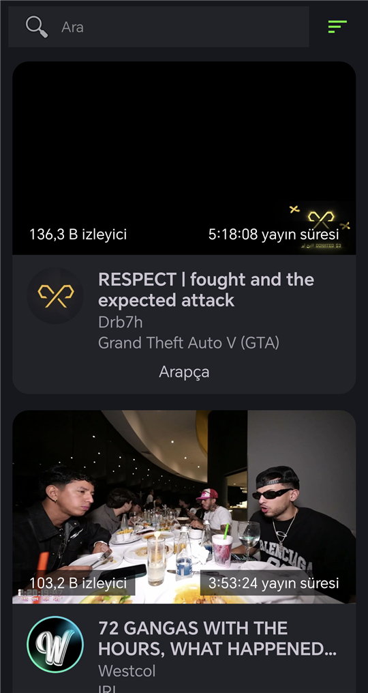
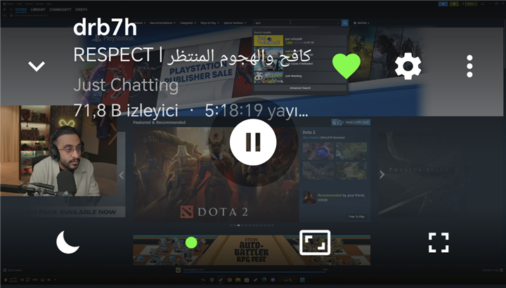

<p align="center">
  
</p>

<p align="center">
  <b><a href="https://kick.com">Kick</a> için resmi olmayan, hafif bir Android istemcisi.</b><br>
  Düşük veri kullanımı, sade bir arayüz ve uzun yayınlar için tasarlanmış bir oynatıcı.
</p>

<p align="center">
  
  
  
</p>

<p align="center">
  <a href="README.md">English</a> · <b>Türkçe</b>
</p>

> Xick, Kick ile bağlantılı değildir ve Kick tarafından onaylanmamıştır. "Kick", sahibinin ticari markasıdır.

---

## Ekran görüntüleri

<table align="center">
  <tr>
    <td align="center"><br><sub>Popüler kanallar</sub></td>
    <td align="center"><br><sub>Canlı oynatıcı ve sohbet</sub></td>
  </tr>
</table>

## Özellikler

**Gezinme**
- Popüler canlı kanallar ve kategoriler, sonsuz kaydırma ile
- Kanal ve kategori araması, dile göre filtreleme

**İzleme**
- Kalite seçimli canlı HLS yayın
- Sığdır, yakınlaştır ve doldur görüntü modları; tam ekran
- Mini oynatıcı: aşağı çekince küçülür, yana kaydırınca kapanır
- Sadece ses modu ve uyku zamanlayıcısı
- Oynatma sürerken ekran en fazla 30 dakika açık kalır
- Her kanal için video arşivi (VOD) ve klipler

**Sohbet**
- Emote'lu canlı sohbet
- Giriş yaptıktan sonra mesaj gönderme

**Takip**
- Kick hesabınla, Kick'in kendi sayfasında giriş (şifreni uygulama görmez)
- Takip ettiğin, şu an canlı olan kanalları görme
- Oynatıcıdan ve listeden takip etme ve takipten çıkma

## Veri tasarrufu

- Küçük resimler mobil veride en küçük uygun boyutta indirilir (`DataSaverPolicy.pickThumbnailUrl`).
- Mobil veride video varsayılan olarak 480p ile sınırlanır; bunu değiştirebilirsin.
- HTTP yanıtları sunucunun `Cache-Control` başlıklarına göre önbelleğe alınır.
- Emote'ler yalnızca bir mesajda göründüğünde yüklenir.
- Sohbetin yan verileri, ilgili sekme açıldığında yüklenir.

## Mimari

- Repository'ler ve Paging 3 ile MVVM
- HLS oynatma için Media3 / ExoPlayer
- Görseller için Coil, ağ için OkHttp, JSON için kotlinx.serialization
- Sohbet için Centrifugo WebSocket

## Kurulum

[Releases](https://github.com/Kurenai10/Xick/releases) sayfasından APK'yı indirip Android cihazına kur (istenirse bilinmeyen kaynaklardan kuruluma izin ver). Release derlemesi bir debug derlemesidir.

## Kaynaktan derleme

Gereksinimler: JDK 17, Android SDK (API 35).

1. Depoyu klonla.
2. Proje kökünde `local.properties` dosyası oluştur. Git tarafından yok sayılır:

   ```properties
   sdk.dir=/Android/Sdk/yolu
   ```

3. Debug APK derle:

   ```bash
   ./gradlew :app:assembleDebug
   ```

   Windows'ta `gradlew.bat :app:assembleDebug` kullan.

APK, `app/build/outputs/apk/debug/` klasörüne yazılır.

## Bilinen sınırlamalar

- Giriş, Kick'in web oturumu üzerinden yapılır. Profil ekranı ve çıkış yap düğmesi henüz yok.
- Kick'in web sitesi ve API'leri herkese açık belgelenmediği için, Kick değiştiğinde uygulamanın bazı kısımlarının güncellenmesi gerekebilir.

## Durum

Erken bir sürüm. Oynatma, gezinme, sohbet ve giriş test cihazlarında çalışıyor.

## Lisans

Lisans dosyası eklenene kadar tüm haklar yazara aittir.
